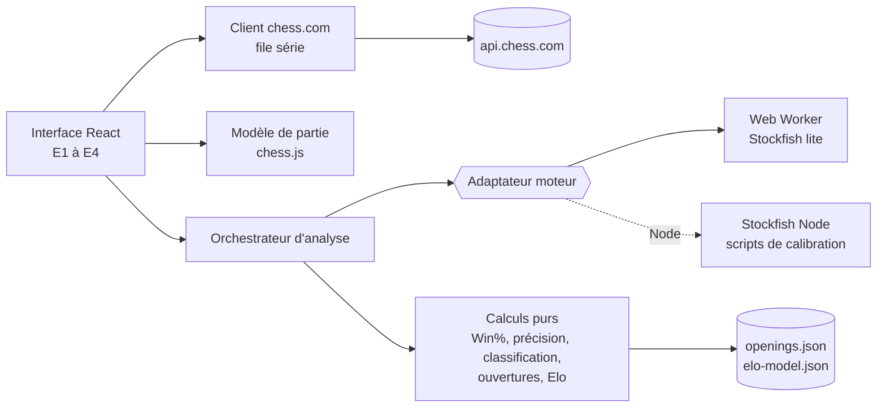

# ChessAnalyser : Architecture technique

> Version 1 · 2026-10-24
> Légende : **[Fait]** · **[H#]** hypothèse · **[Reco]** recommandation · **[À vérifier]**

## 1. Résumé

| Couche | Choix | Pourquoi | Alternative écartée |
|---|---|---|---|
| Interface | React 19 + TypeScript, construit avec Vite ; échiquier `react-chessboard` (MIT) ; courbe en SVG maison | Écosystème le plus outillé, composant d'échiquier MIT compatible React 19 **[Fait]** (peerDependencies `^19.0.0`) | Chessground (GPL-3.0, conçu pour Snabbdom, intégration plus lourde) ; bibliothèque de graphiques (dépendance pour une seule courbe) |
| Logique échecs | `chess.js` 1.4.0 (BSD-2-Clause) | Lecture PGN, SAN/UCI, FEN, coups légaux ; bibliothèque de référence | Écrire un générateur de coups (inutile) |
| Moteur | `stockfish` 19.0.1, variante `stockfish-19-lite-single` (≈ 1,7 Mo) dans un Web Worker | Tourne sans en-têtes COOP/COEP, recommandée par l'auteur pour la plupart des projets **[Fait]** | Moteur complet (≈ 94 Mo, F16 en V2) ; serveur d'analyse (contraire à H3) |
| Stockage | `localStorage` pour le dernier pseudo et le préréglage | Seules données persistantes du MVP | IndexedDB (utile pour F9, V2) |
| Serveur / services | Aucun serveur. Site statique ; seule dépendance réseau : API publique chess.com | CORS ouvert (`Access-Control-Allow-Origin: *`) **[Fait]** (requête du 2026-10-24) | Proxy serveur (inutile tant que le CORS reste ouvert, repli de R1) |
| Tests | Vitest (unitaire, intégration Node), Playwright (bout en bout dans Chromium et Firefox) | Standard de l'écosystème Vite | Jest (configuration ESM plus lourde) |
| Distribution | Usage local (`npm run dev`) pendant le MVP ; puis hébergement statique gratuit (D5) | Rien à exploiter ni à payer | Serveur dédié |

Versions relevées sur le registre npm le 2026-10-24 : react 19.3.1, vite 8.3.5, typescript 7.0.2, vitest 5.0.5, @playwright/test 1.64.1, chess.js 1.4.0, react-chessboard 5.12.1, stockfish 19.0.1. Node 24.22.1 et npm 11.19.1 sont installés sur la machine. T1 fige les versions dans `package-lock.json`. **Écart constaté en T1** : TypeScript 6.0.3 au lieu de 7.0.2, car `typescript-eslint` 8.72.0 déclare `typescript >=4.8.4 <6.1.0` **[Fait]** (registre npm, 2026-10-24). Passer à TypeScript 7 quand `typescript-eslint` le prendra en charge. L'API de `react-chessboard` 5 a été lue dans ses définitions de types en T4 : un objet `options` avec `position`, `boardOrientation`, `arrows`, `squareStyles`, `allowDragging` et `id` **[Fait]**. Les pièces sont focalisables par défaut ; l'échiquier est donc rendu `inert` tant qu'il n'est pas interactif.

## 2. Contexte existant

Nouveau projet, aucun code existant. Dossier non versionné : T1 initialise git.

## 3. Composants



- **Client chess.com** (`src/api/`) : file d'attente qui n'envoie qu'une requête à la fois, validation de la forme des réponses, traduction des erreurs (404, 429, 5xx, réseau) en erreurs typées.
- **Modèle de partie** (`src/chess/`) : PGN vers liste de demi-coups avec FEN avant et après, SAN, UCI, nombre de coups légaux, horloge si présente.
- **Adaptateur moteur** (`src/engine/`) : interface `evaluate(fen, depth, signal) => PositionEval` qui parle UCI. Deux implémentations : Web Worker pour le navigateur, processus Node pour les scripts. La même logique d'analyse sert ainsi au site et à la calibration de l'Elo, condition pour que le modèle F6 soit valide.
- **Orchestrateur** (`src/analysis/runAnalysis.ts`) : évalue les N+1 positions en série, publie la progression, gère l'annulation.
- **Calculs purs** (`src/analysis/`) : fonctions sans effet de bord, testables sans moteur ni navigateur.
- **Données embarquées** (`src/data/`) : `openings.json` généré depuis la base Lichess (CC0) ; `elo-model.json` produit par le script de calibration.

## 4. Local ou serveur

| Fonction | Où elle s'exécute | Service externe | Clé secrète | Repli si indisponible |
|---|---|---|---|---|
| F1 Recherche et liste | Local (navigateur) | API publique chess.com | Non | Message et « Réessayer » ; V2 : import PGN (F8) |
| F2 Échiquier | Local | Aucun | Non | Sans objet |
| F3 Analyse | Local (Web Worker) | Aucun | Non | Message, navigation conservée |
| F4 Barre et courbe | Local | Aucun | Non | Sans objet |
| F5 Classification | Local | Aucun (base d'ouvertures embarquée) | Non | Sans objet |
| F6 Elo | Local (modèle embarqué) | Aucun à l'exécution | Non | Sans objet |
| F7 Synthèse | Local | Aucun | Non | Sans objet |
| Calibration Elo (scripts) | Machine du développeur (Node) | API publique chess.com | Non | Téléchargement manuel des PGN mensuels depuis un navigateur |

Contrainte H3 vérifiée ligne par ligne : aucune API payante, aucun serveur, aucune clé.

## 5. Modèle de données

Toutes les données vivent en mémoire pendant la session, sauf mention contraire. Format versionné par `schemaVersion: 1`.

- `GameSummary` (réponse de l'archive mensuelle) : `url`, `endTime`, `timeClass`, `rules`, `rated`, `white` et `black` (`username`, `rating`, `result`), `pgn`, `accuracies?`. Champs observés le 2026-10-24 : `time_class` est présent dans l'archive mensuelle, `accuracies` dans 434 parties sur 435.
- `ParsedGame` : `headers`, `startFen`, `plies: Ply[]`.
- `Ply` : `index`, `color`, `san`, `uci`, `fenBefore`, `fenAfter`, `legalMoveCount`, `clockSeconds?`.
- `PositionEval` : `fen`, `depth`, `cp?` ou `mate?` (point de vue des blancs), `bestMoveUci?`, `pv: string[]`.
- `MoveAnalysis` : `plyIndex`, `winBefore`, `winAfter` (point de vue du joueur), `loss`, `accuracy`, `category`, `bestMoveSan?`.
- `GameAnalysis` : `schemaVersion`, `preset`, `engine` (`stockfish-19-lite-single`), `positions`, `moves`, `complete`, `players.white|black` (`accuracy`, `counts`, `elo?` : `value`, `low`, `high`, `modelVersion`).
- `elo-model.json` : `version`, `preset`, `timeClass`, coefficients, quantiles des résidus, `trainedOn` (nombre de parties, période).
- `openings.json` : `names` (EPD vers `[eco, nom]`, 3865 positions) et `book` (4117 positions intermédiaires des lignes connues, sans nom propre), soit 723 Ko bruts et 93 Ko compressés, chargés à la demande dans un fichier séparé (T6).
- Score moteur (T5) : `{ cp }` ou `{ mate, winner }` du point de vue des blancs ; `mate: 0` pour une position déjà matée, évaluée sans moteur.
- `localStorage`, clé `chessanalyser:v1` : `{ lastUsername, preset }`.
- Jeu de calibration : fichiers locaux dans `data/` (exclu de git), jamais publiés.

Volume : une partie fait au plus quelques centaines de positions ; rien ne dépasse quelques Mo en mémoire.

## 6. Interfaces et intégrations

**API chess.com** **[Fait]** (documentation et requêtes du 2026-10-24) :
- `GET https://api.chess.com/pub/player/{pseudo}/games/archives` : liste des archives mensuelles, ordre chronologique croissant ; 404 JSON `{"code":0,"message":"User \"…\" not found."}` pour un pseudo inconnu.
- `GET https://api.chess.com/pub/player/{pseudo}/games/{AAAA}/{MM}` : parties du mois, PGN avec horloges `%clk`.
- Accès en série illimité ; en parallèle, réponses 429 possibles ; blocage possible en cas d'activité anormale.
- Données rafraîchies au plus toutes les 12 ou 24 heures selon la page (contradiction dans la documentation) : une partie jouée il y a quelques minutes peut manquer. Message à prévoir dans E2.
- `ETag` et `Last-Modified` disponibles pour des requêtes conditionnelles.
- Un client non navigateur sans User-Agent explicite a reçu un défi Cloudflare (403) ; les scripts Node envoient un User-Agent identifiable avec un contact, comme le recommande la documentation. Depuis le navigateur, le User-Agent est celui du navigateur.

**Protocole UCI** (Worker) : `uci`, `setoption name Threads value 1`, `setoption name Hash value 16` **[Reco]**, `isready`, `ucinewgame`, `position fen …`, `go depth N`, lecture des lignes `info … score cp|mate … pv …` et `bestmove`, `stop` pour annuler. Le score UCI est du point de vue du camp au trait : l'adaptateur le ramène au point de vue des blancs.

**Fichiers moteur** : `stockfish-19-lite-single.js` et `.wasm` copiés de `node_modules/stockfish` vers `public/engine/` par un script de build ; les noms exacts sont **[À vérifier]** dans le paquet installé (le paquet fait environ 205 Mo décompressé **[Fait]** d'après le registre : seuls ces deux fichiers sont copiés).

## 7. Authentification et permissions

Sans objet : aucune donnée privée, aucun compte. Les parties lues sont publiques.

## 8. Sécurité, validation et erreurs

- **Entrées** : pseudo validé par expression régulière puis `encodeURIComponent` ; réponses JSON vérifiées champ par champ avant usage (une partie invalide est ignorée et journalisée en console) ; PGN lu dans un `try` ; lignes UCI analysées de façon défensive.
- **Sorties** : React échappe le texte ; aucun `dangerouslySetInnerHTML`.
- **Politique de sécurité du contenu** **[Reco]** : `default-src 'self'; connect-src 'self' https://api.chess.com; script-src 'self' 'wasm-unsafe-eval'; worker-src 'self'; img-src 'self' data:`. La nécessité de `'wasm-unsafe-eval'` pour Stockfish est **[À vérifier]** en T5. Cette politique rend AC-X-2 vérifiable.
- **Liens sortants** : `rel="noopener noreferrer"`.
- **Secrets** : aucun. Pas de `.env` nécessaire ; `.gitignore` exclut tout de même `.env*` et `data/`.
- **Erreurs** : message clair à l'utilisateur, détail technique en console ; une erreur d'analyse sur une position marque l'analyse incomplète sans perdre les positions déjà évaluées.

## 9. Dépendances

| Dépendance | Rôle | Licence | Coût | Alternative |
|---|---|---|---|---|
| stockfish 19.0.1 | Moteur | GPL-3.0 **[Fait]** | 0 | Aucune de force comparable en WASM |
| chess.js 1.4.0 | Règles, PGN | BSD-2-Clause **[Fait]** | 0 | chessops (GPL-3.0) |
| react-chessboard 5.12.1 | Échiquier | MIT **[Fait]** | 0 | chessground (GPL-3.0-or-later) |
| react 19.3.1 | Interface | MIT **[Fait]** | 0 | Svelte, Vue |
| vite 8.3.5, typescript 7.0.2 | Build, typage | MIT, Apache-2.0 **[Fait]** | 0 | Sans objet |
| vitest 5.0.5, @playwright/test 1.64.1 | Tests | MIT, Apache-2.0 **[Fait]** | 0 | Jest, Cypress |
| lichess-org/chess-openings | Noms d'ouvertures | CC0-1.0 **[Fait]** | 0 | Code ECO seul (moins lisible) |

Conséquence de la licence de Stockfish : le projet est publié sous GPL-3.0 (D1).

## 10. Tests

- **Unitaire (Vitest)** : `src/analysis/*`, `src/chess/*`, `src/api/*` avec `fetch` simulé et réponses chess.com enregistrées dans `tests/fixtures/`.
- **Intégration (Vitest, Node)** : adaptateur moteur Node sur des positions connues (mat en 1, position initiale) ; marqués lents, lancés par `npm run test:engine`.
- **Bout en bout (Playwright)** : parcours P1 avec `api.chess.com` simulée par interception réseau et vrai moteur dans Chromium et Firefox.
- **Validation du modèle Elo** : `npm run elo:validate` sur le jeu de validation local.
- **Manuel** : scénarios M1 à M5 de RISKS_AND_TESTS.md.
- **Commande unique** : `npm test` (unitaire et intégration rapide) ; `npm run test:all` ajoute moteur et bout en bout.

## 11. Build, déploiement et maintenance

- `npm run dev` : serveur de développement local.
- `npm run build` : copie des fichiers moteur, génération de `openings.json` si absent, build statique dans `dist/`.
- Hébergement (D5) : GitHub Pages ou Cloudflare Pages en offre gratuite **[À vérifier]** au moment de publier ; vérifier que le `.wasm` est servi avec le type `application/wasm` **[À vérifier]**.
- Maintenance : surveiller les changements de l'API chess.com (R1) ; mettre à jour Stockfish implique de recalibrer le modèle Elo (le modèle mentionne la version du moteur).

## 12. Coûts récurrents

| Poste | Coût | Source |
|---|---|---|
| API chess.com | 0 | Documentation de l'API, consultée le 2026-10-24 (aucune clé ni tarif) |
| Calcul moteur | 0 (machine de l'utilisateur) | Architecture |
| Hébergement statique | 0 visé | **[À vérifier]** conditions de l'offre gratuite choisie |
| Nom de domaine | Optionnel | **[À vérifier]** |

## 13. Décisions d'architecture

- **ADR-1 : aucun serveur.** Les données sont publiques, aucune clé n'est nécessaire, le calcul tient dans le navigateur. Conséquence : coût nul, mais dépendance directe au CORS de chess.com (R1) et à la puissance de la machine (R3).
- **ADR-2 : profondeur fixe plutôt que temps fixe.** Des résultats reproductibles d'une machine à l'autre sont indispensables pour que le modèle Elo calibré en Node reste valable dans le navigateur. Conséquence : durée variable selon la machine.
- **ADR-3 : un seul adaptateur moteur pour le site et les scripts.** Évite que le modèle Elo soit calibré sur des évaluations différentes de celles du site.
- **ADR-4 : seuils de classification en Win% plutôt qu'en centipions.** Une perte de 2 pions compte peu quand on gagne déjà de 10 pions ; le Win% reflète l'effet réel sur l'issue.
- **ADR-5 : GPL-3.0.** Imposée par la distribution de Stockfish (D1).

## 14. Arborescence proposée

```
ChessAnalyser/
  product/                  documents de cadrage
  public/engine/            fichiers Stockfish copiés au build (non versionnés)
  scripts/
    copy-engine.mjs
    build-openings.ts       TSV Lichess -> src/data/openings.json
    collect-games.ts        jeu de calibration (série, User-Agent identifiable)
    analyse-dataset.ts      analyse Node des parties collectées
    calibrate-elo.ts        -> src/data/elo-model.json
    validate-elo.ts         contrôle AC-F6-4
  src/
    api/chesscom.ts
    chess/game.ts
    engine/{types.ts, worker-engine.ts, node-engine.ts, uci.ts}
    analysis/{winPercent.ts, accuracy.ts, classify.ts, openings.ts, keyMoments.ts, elo.ts, runAnalysis.ts}
    data/{openings.json, elo-model.json}
    ui/{SearchPage, GameList, AnalysisView, Board, EvalBar, EvalGraph, MoveList, MovePanel, Summary}.tsx
  tests/{fixtures/, unit/, e2e/}
  data/                     jeu de calibration local (non versionné)
  LICENSE                   GPL-3.0
  README.md
```
